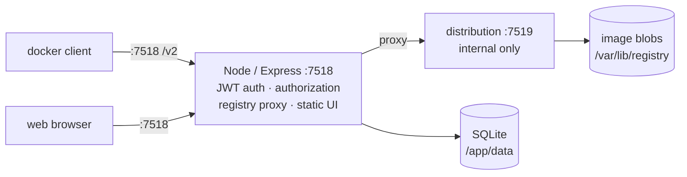

<div align="center">


# iDocker Registry

**A Docker image registry with a web management UI**

Namespace / Project / Repository hierarchy · Repository-level RBAC · Registry v2 proxy · Audit logging · Bilingual UI

[简体中文](README.md) | [English](README.en.md)

[](https://hub.docker.com/r/idockervip/idocker-registry)
[](LICENSE)

</div>

---

## Overview

iDocker Registry adds a management UI and a permission model on top of the native Docker Registry. It *is* the proxy for the registry: every `docker pull` / `push` request is authenticated and authorized here before being forwarded to the internal `distribution` instance. Image access control, operation auditing, and tag synchronization therefore all happen in one place.

You don't need a full Harbor deployment just to have a registry with access control.

```bash
docker pull idockervip/idocker-registry:2.0.4
```

### Key Features

- **Three-tier resource model** — Namespace → Project → Repository. Namespaces group by team, projects map to image path prefixes, repositories are individual service images.
- **Repository-level RBAC** — 4 system roles, and membership is granted per **repository** rather than per project, so cross-team collaboration does not require broad permissions.
- **Built-in public library** — The `default` project holds shared base images (nginx / mysql / redis / jdk) under **single-segment paths** (`idocker.vip/nginx:latest`), pullable by any signed-in user.
- **Recycle bin** — Deleting namespaces / projects / repositories is a soft delete: entries can be restored or permanently purged. Permanent deletion does not cascade, preventing accidental loss of an entire subtree.
- **Audit logging** — Logins, image operations, and permission changes are all persisted, with search, filtering, export, and retention-based cleanup.
- **Instant sync** — Tags appear immediately after a push; the newest tag is automatically mirrored as `latest`, so `docker pull <repo>` always resolves to the newest build.
- **Bilingual UI, three themes** — Switch between Chinese and English; light / dark / follow-system themes.

---

## Architecture



- Only **7518** needs to be exposed — it serves the web UI, the REST API, and the Docker Registry API.
- The internal registry listens on **7519**, is not published to the host, and only accepts proxied traffic from this container.
- Image data lives in `/var/lib/registry`, metadata (SQLite) in `/app/data`, logs in `/app/logs`.

### Tech Stack

| Layer | Choice |
|-------|--------|
| Frontend | Vue 3 (Composition API) + TypeScript + Vite + Pinia + vue-i18n + SCSS |
| Backend | Node.js + Express |
| Database | SQLite (WAL mode) |
| Auth | JWT + bcrypt |
| Registry | CNCF distribution 2.8.3 |
| Logging | Winston |
| Proxy | http-proxy-middleware |

---

## Quick Start

### Option 1: Use the official image (recommended)

Published on Docker Hub as **`idockervip/idocker-registry`**.

```bash
# 1) Prepare data directories and fix ownership (see the note below — this matters)
mkdir -p registry data logs
sudo chown -R 1000:1000 registry data logs

# 2) Run
docker run -d --name idocker-registry \
  -p 7588:7518 \
  -e IDOCKER_REGISTRY_URL=http://localhost:7588 \
  -v "$PWD/registry:/var/lib/registry" \
  -v "$PWD/data:/app/data" \
  -v "$PWD/logs:/app/logs" \
  --restart unless-stopped \
  idockervip/idocker-registry:2.0.4
```

Or use the compose file from this repository (no edits needed — override the image via environment variable):

```bash
git clone <your-repo-url> idocker-registry && cd idocker-registry
IDOCKER_IMAGE=idockervip/idocker-registry:2.0.4 docker compose up -d
```

> Set `IDOCKER_REGISTRY_URL` to your real public hostname — it determines the CORS origin and how image URLs are assembled.

### Option 2: Build from source

```bash
git clone <your-repo-url> idocker-registry
cd idocker-registry

# 1) Build the image
docker build -t idocker-registry:latest .

# 2) Prepare data directories and fix ownership
mkdir -p registry data logs
sudo chown -R 1000:1000 registry data logs

# 3) Start
docker compose up -d
```

### Signing in to the web UI

Open `http://localhost:7588` and log in with the default account:

```
Username: admin
Password: admin123
```

> **Change the admin password right after the first login.** Password rule: at least 6 characters and **must contain at least 1 special character**.

### ⚠️ Directory ownership

The container runs as **uid 1000 (the `node` user)**, and bind mounts override the ownership of directories baked into the image. If a host directory belongs to root, the container cannot write its database and fails with:

```
error: Server startup failed: SQLITE_CANTOPEN: unable to open database file
```

Fix:

```bash
sudo chown -R 1000:1000 registry data logs
docker compose restart      # or: docker restart idocker-registry
```

Wrong ownership on `registry` makes every push fail; on `data` the container fails to start; on `logs` startup is interrupted as well.

> The container does create these directories if missing, but **they will be owned by root**, so the first start still fails. Creating them and running `chown` beforehand is necessary.

### About the base image

When building from source, the `Dockerfile` uses `idocker.vip/node:22` — **a private registry maintained by this project's author, not anonymously pullable**. Switch to a public image before building in your own environment:

```dockerfile
FROM node:22-alpine AS ui-builder
```

The `server-deps` stage compiles the `sqlite3` native module; `node:22-alpine` needs `python3 make g++ sqlite-dev` (already installed in the Dockerfile), while non-Alpine images need `build-essential` and `libsqlite3-dev`.

> If you just want to *use* the project, **pull the official image and skip this section**.

---

## Usage

### Registry login (docker login)

Web credentials are Docker credentials:

```bash
docker login idocker.vip
```

### Pulling base images (single-segment path)

Images in the `default` project carry no project segment and are pullable by every signed-in user:

```bash
docker pull idocker.vip/nginx:latest
docker pull idocker.vip/mysql:latest
```

### Project images (two-segment path)

All other images use `project/repository`:

```bash
docker pull idocker.vip/wvp/media-worker:latest
docker push idocker.vip/wvp/media-worker:latest
```

> **Create the repository in the web UI before pushing.** Non-admin users cannot create repositories implicitly by pushing — if the target repository is not in the database, the push is rejected with 403.

### Pushing and tagging

```bash
docker tag my-app:dev idocker.vip/wvp/media-worker:v1.2.3
docker push idocker.vip/wvp/media-worker:v1.2.3
```

Tags show up in the UI immediately after a successful push. If the newest tag is not `latest`, the system additionally pushes that digest under `latest`, so `docker pull idocker.vip/wvp/media-worker` always resolves to the newest build.

---

## Permissions

### System roles (`users.role`)

| Role | Identifier | Scope | Docker actions |
|------|-----------|-------|----------------|
| Administrator | `admin` | All resources, no membership required | pull / push / delete |
| Project manager | `project_manager` | Member management for the repositories they manage | pull / push / delete |
| Developer | `developer` | Read/write repository images | pull / push / delete |
| Operator | `operator` | Read-only repository images | pull only |

`admin` has full access to every repository and does **not** need to be added as a repository member.

### Repository members

The single source of truth for image access is the `repository_members` table, whose role enum is `project_manager` / `developer` / `operator`.

"Project membership" is a derived concept — it means membership of **any repository** under that project. There is no separate storage for it, so granting access to one repository in a project does not grant access to the others.

### The default project

- The `default` namespace and the `default` project are **protected: they cannot be deleted, renamed, or deactivated** (the API returns 409).
- Images in the `default` project are visible and pullable by all signed-in users.
- Pushing into `default` requires admin or an explicitly granted membership.

---

## Configuration

### Environment variables

A production deployment usually needs **exactly one** setting:

| Variable | Default | Description |
|----------|---------|-------------|
| `IDOCKER_REGISTRY_URL` | `http://localhost:7518` | **Public URL** — determines the CORS origin and image URL assembly. The bundled `docker-compose.yaml` ships with `https://idocker.vip`; change it to your own domain before deploying |

Everything else has a sensible default and can be overridden as needed:

| Variable | Default | Description |
|----------|---------|-------------|
| `PORT` | `7518` | Web / API port |
| `DB_PATH` | `/app/data/registry.db` | SQLite path |
| `LOG_DIR` | `/app/logs` | Log directory |
| `LOG_LEVEL` | `info` | Log level |
| `JWT_EXPIRES_IN` | `24h` | Token lifetime |
| `JWT_SECRET` | auto-generated | See below |
| `DEFAULT_ADMIN_PASSWORD` | `admin123` | Used only when the database is first created |
| `ALLOW_USER_REGISTRATION` | `false` | Enables the self-service registration endpoint; see Known Limitations |
| `DOCKER_REGISTRY_TIMEOUT` | `30000` | Timeout for proxying to the internal registry (ms) |
| `DOCKER_REGISTRY_URL` | fixed `http://localhost:7519` | **Hard-coded constant; not overridable via environment** |

The internal registry address is fixed at `http://localhost:7519` (the `distribution` instance in the same container), so for a single-container deployment it neither needs nor accepts configuration.

### Automatic secret management

Both secrets are **generated on first start and persisted to the data directory**, then reused across restarts — no manual configuration required:

| Secret | Location | Purpose |
|--------|----------|---------|
| `JWT_SECRET` | `<data dir>/.env` (0600) | Signs and verifies login tokens. Losing it invalidates every session |
| `REGISTRY_HTTP_SECRET` | `<data dir>/.registry_http_secret` (0600) | Signs upload state. Losing it invalidates in-flight uploads on restart |

Only multi-instance deployments need to share `JWT_SECRET` explicitly via environment variable (the environment variable then takes precedence and is not written to disk).

Neither secret ever enters the image — both live only in the mounted data volume.

### Frontend build-time variables (`idocker-registry-ui/.env`)

| Variable | Default | Description |
|----------|---------|-------------|
| `VITE_REGISTRY_URL` | empty | Leave empty to use relative paths (recommended for same-origin deployments) |
| `VITE_THEME` | `auto` | Initial theme: `light` / `dark` / `auto` |
| `VITE_DELETE_IMAGES` | `true` | Whether delete actions are shown in the UI |
| `VITE_TAGLIST_ORDER` | `alpha-asc;num-desc` | Tag ordering strategy |
| `VITE_SHOW_CONTENT_DIGEST` | `true` | Whether to display image digests |

These are inlined at **build time**; changing them requires rebuilding the frontend.

---

## API Overview

All `/api/*` endpoints except login and registration require `Authorization: Bearer <token>`.

| Endpoint | Description |
|----------|-------------|
| `POST /api/auth/login` | Log in, returns a JWT |
| `POST /api/auth/register` | Register |
| `GET /api/auth/profile` | Current user profile |
| `PUT /api/auth/change-password` | Change password |
| `/api/users/*` | User management (admin only) |
| `/api/namespaces/*` | Namespace CRUD; `POST /:id/restore` restores from the recycle bin |
| `/api/projects/*` | Project management; `POST /:id/restore` restores |
| `/api/repository/*` | Repositories, tags, members; `POST /:id/restore` restores |
| `GET /api/audit/logs` | Audit logs (also `statistics` / `actions` / `export` / `cleanup`) |
| `GET /api/sync/status` | Sync status (also `POST /all` / `POST /project/:id` / `GET /logs`) |
| `/v2/*` | Docker Registry v2 API (authenticated and proxied) |

List endpoints accept `deleted=0|1|all` to select active / recycled / all entries.

Responses follow a consistent shape:

```json
{ "success": true, "data": { } }
{ "success": false, "message": "..." }
```

Paginated responses include `pagination: { page, limit, total, totalPages, hasNextPage, hasPrevPage }`.

---

## Local Development

### Option 1: Containerized backend (recommended)

The backend and internal registry run in a container with the source mounted for live reload; the frontend runs Vite on the host.

```bash
# Prepare data directories (first time only)
mkdir -p test/dev-registry-data test/dev-app-data test/dev-app-logs
sudo chown -R 1000:1000 test/dev-registry-data test/dev-app-data test/dev-app-logs

# Terminal 1: backend + registry (host port 8031)
docker compose -f docker-compose.dev.yaml up

# Terminal 2: frontend dev server (8030, proxies /api and /v2 to 8031)
cd idocker-registry-ui && npm install && npm run dev:client
```

Visit `http://localhost:8030`. Backend changes reload automatically; changes to `package.json` dependencies or frontend code require rebuilding the image.

### Option 2: Everything on the host

```bash
# Backend
cd idocker-registry-server && npm install
PORT=8031 node index.js

# Frontend
cd idocker-registry-ui && npm install && npm run dev:client
```

### Build and checks

```bash
# Frontend (= vue-tsc --noEmit && vite build; no artifacts if type-checking fails)
cd idocker-registry-ui && npm run build

# Backend smoke tests (covers only the apiResponse / messages pure-logic modules)
cd idocker-registry-server && npm test

# Syntax check
node --check idocker-registry-server/routes/projects.js
```

> `npm run lint` in the frontend is currently broken: `.eslintrc.cjs` depends on `@rushstack/eslint-patch`, which is not listed in `devDependencies`.
>
> The `dev` / `dev:server` / `build:server` / `start` / `init-db` scripts in `idocker-registry-ui/package.json` run `cd idocker-registry-server`, but no such subdirectory exists under the UI directory, so those scripts are inert in this layout. Only `dev:client` and `build` work.

---

## Project Layout

```
.
├── Dockerfile                    # multi-stage: frontend → backend deps → runtime
├── docker-compose.yaml           # production (image + bind mounts: registry / data / logs)
├── docker-compose.dev.yaml       # development (source mounted, live reload)
├── deploy/
│   ├── config.yaml               # internal registry config
│   ├── docker-entrypoint.sh      # production entrypoint: starts registry + backend
│   ├── dev-entrypoint.sh         # dev entrypoint: node --watch
│   ├── registry-http-secret.sh   # resolves/persists http.secret
│   └── registry-gc.md            # offline garbage collection guide
├── idocker-registry-server/
│   ├── index.js                  # entrypoint: middleware, route registration
│   ├── config/                   # env / database (incl. migrations) / jwtSecret
│   ├── middleware/               # JWT auth, error handling
│   ├── models/                   # data access layer (BaseModel CRUD)
│   ├── routes/                   # auth / users / namespaces / projects /
│   │                             # repository / dockerRegistry / audit / sync
│   ├── services/                 # auth, Docker authorization, registry I/O, sync
│   └── utils/                    # response helpers, logging, Docker utilities
└── idocker-registry-ui/
    ├── src/
    │   ├── views/                # pages (admin/ is the management area)
    │   ├── components/           # components (dialogs/ holds modals)
    │   ├── stores/               # Pinia: auth / registry
    │   ├── services/             # API wrappers
    │   ├── composables/          # composables
    │   ├── i18n/locales/         # zh-CN / en-US
    │   ├── styles/               # SCSS variables and theming
    │   └── types/                # TypeScript types
    └── vite.config.ts            # port 8030, proxies /api and /v2 to 8031
```

---

## Operations

### Upgrading

Image data and metadata are decoupled, so upgrading normally means replacing the image and restarting:

```bash
docker compose pull     # or rebuild with docker build
docker compose up -d
```

Schema changes are applied automatically by `initDatabase()` on startup (columns are added first, then indexes on those columns), so no manual migration is needed. Back up the whole data directory after stopping the container:

```bash
docker compose down
sudo cp -a data data.bak-$(date +%F)
```

> In WAL mode the newest writes may still be in `registry.db-wal`. **Do not copy `registry.db` on its own** — either copy the entire directory or stop the container first.

### Reclaiming disk space

Deleting tags or repositories does not immediately free blob storage; garbage collection must be run offline while the registry is stopped or read-only. Full procedure: [`deploy/registry-gc.md`](deploy/registry-gc.md).

### Logs

| File | Contents |
|------|----------|
| `logs/combined.log` | All levels |
| `logs/error.log` | Errors only |
| `logs/exceptions.log` | Uncaught exceptions (**check here first when startup fails**) |
| `logs/rejections.log` | Unhandled promise rejections |

When startup fails, `docker logs` sometimes stops at `database connect success`; the real cause is in `exceptions.log`.

---

## Known Limitations

- **Single-instance deployment** — the internal registry shares a container with the backend, so horizontal scaling isn't possible; multiple replicas would require an external registry and architectural changes.
- **No LDAP / OAuth** — the login form has an `ldapAuth` field, but the backend does not implement it.
- **Registration is disabled by default** — `POST /api/auth/register` returns 403 unless `ALLOW_USER_REGISTRATION=true` is set. Once enabled, the endpoint requires **no authentication**, so be careful on internet-facing deployments.
- **Frontend build warns on Node 18** — `sass@1.104` requires Node ≥ 20.19; Node 18 prints `EBADENGINE` but still builds. The container uses Node 22.

---

## Contributing

Issues and pull requests are welcome. Before submitting:

1. Frontend changes: run `npm run build` (includes type checking)
2. Backend changes: run `node --check` and `npm test`
3. Database migrations: **add columns before creating indexes on them**, and keep them idempotent for older databases

---

## License

MIT — see [LICENSE](LICENSE).
