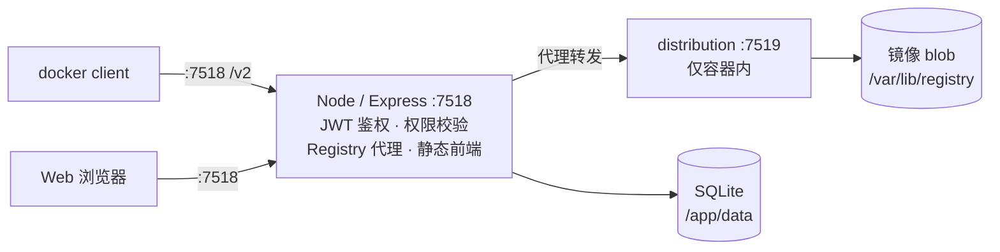

<div align="center">


# iDocker Registry

**带 Web 管理界面的 Docker 镜像仓库管理平台**

命名空间 / 项目 / 仓库三层管理 · 仓库级 RBAC · Registry v2 代理 · 审计日志 · 中英双语

[简体中文](README.md) | [English](README.en.md)

[](https://hub.docker.com/r/idockervip/idocker-registry)
[](LICENSE)

</div>

---

## 简介

iDocker Registry 在原生 Docker Registry 之上加了一层管理界面与权限体系。它本身就是 Registry 的代理：所有 `docker pull` / `push` 请求经由它鉴权后再转发给内部的 `distribution` 实例，因此镜像访问权限、操作审计、标签同步都在同一处完成。

不需要为了用一个镜像仓库就搭一整套 Harbor。

```bash
docker pull idockervip/idocker-registry:2.0.4
```

### 核心特性

- **三层资源模型** —— 命名空间 → 项目 → 仓库。命名空间按团队分组，项目对应镜像路径前缀，仓库即单个微服务镜像。
- **仓库级细粒度权限** —— 4 种系统角色，成员关系落在**仓库**一级而非项目一级，跨团队协作时不必放大权限。
- **内置公共库** —— `default` 项目存放 nginx / mysql / redis / jdk 等基础镜像，使用**单段路径**（`idocker.vip/nginx:latest`），所有登录用户可拉取。
- **回收站** —— 命名空间 / 项目 / 仓库删除为「假删除」，可恢复，也可物理清除。物理删除不级联，避免误删整棵子树。
- **审计日志** —— 登录、镜像操作、权限变更全部落库，支持搜索、筛选、导出与按保留期清理。
- **即时同步** —— push 成功后标签立即入库；自动把最新标签镜像为 `latest`，`docker pull <repo>` 恒为最新。
- **中英双语 + 三种主题** —— 界面语言可切换；浅色 / 深色 / 跟随系统。

---

## 架构



- 只需暴露 **7518**（Web UI + REST API + Docker Registry API 三合一入口）。
- 内部 registry 监听 **7519**，不对宿主暴露，仅接受本容器的代理转发。
- 镜像数据在 `/var/lib/registry`，元数据（SQLite）在 `/app/data`，日志在 `/app/logs`。

### 技术栈

| 层 | 选型 |
|----|------|
| 前端 | Vue 3 (Composition API) + TypeScript + Vite + Pinia + vue-i18n + SCSS |
| 后端 | Node.js + Express |
| 数据库 | SQLite（WAL 模式） |
| 认证 | JWT + bcrypt |
| Registry | CNCF distribution 2.8.3 |
| 日志 | Winston |
| 代理 | http-proxy-middleware |

---

## 快速开始

### 方式一：使用官方镜像（推荐）

镜像已发布到 Docker Hub：**`idockervip/idocker-registry`**

```bash
# 1) 准备数据目录并修正属主（关键，见下方说明）
mkdir -p registry data logs
sudo chown -R 1000:1000 registry data logs

# 2) 启动
docker run -d --name idocker-registry \
  -p 7588:7518 \
  -e IDOCKER_REGISTRY_URL=http://localhost:7588 \
  -v "$PWD/registry:/var/lib/registry" \
  -v "$PWD/data:/app/data" \
  -v "$PWD/logs:/app/logs" \
  --restart unless-stopped \
  idockervip/idocker-registry:2.0.4
```

也可以用仓库内的 compose（需先拿到 `docker-compose.yaml`；无需修改文件，用环境变量覆盖镜像）：

```bash
git clone <your-repo-url> idocker-registry && cd idocker-registry
IDOCKER_IMAGE=idockervip/idocker-registry:2.0.4 docker compose up -d
```

> 把 `IDOCKER_REGISTRY_URL` 改成实际对外域名（决定 CORS origin 与镜像 URL 拼接）。

### 方式二：从源码构建

```bash
git clone <your-repo-url> idocker-registry
cd idocker-registry

# 1) 构建镜像
docker build -t idocker-registry:latest .

# 2) 准备数据目录并修正属主
mkdir -p registry data logs
sudo chown -R 1000:1000 registry data logs

# 3) 启动
docker compose up -d
```

### 登录 Web 界面

打开 `http://localhost:7588`，用默认账号登录：

```
用户名：admin
密码：admin123
```

> **首次登录后请立即修改 admin 密码。** 密码规则：至少 6 位且**必须包含至少 1 个特殊字符**。

### ⚠️ 关于目录属主

容器以 **uid 1000（`node` 用户）** 运行，而 bind mount 会覆盖镜像内目录的属主。如果宿主目录属于 root，容器将无法写入数据库，报错形如：

```
error: Server startup failed: SQLITE_CANTOPEN: unable to open database file
```

修复：

```bash
sudo chown -R 1000:1000 registry data logs
docker compose restart      # 或 docker restart idocker-registry
```

`registry` 属主不对会导致 push 全部失败；`data` 属主不对会导致启动即失败；`logs` 属主不对同样会中断启动。

> 容器虽然会自动创建这三个目录，但**创建出来默认属于 root**，首次启动仍会失败。先建目录并 chown 是必要的。

### 关于基础镜像

源码构建时 `Dockerfile` 基于 `idocker.vip/node:22`——**这是本项目作者维护的私有镜像仓库地址，外部用户无法匿名拉取**。在自己的环境中构建前请改用公共镜像，例如：

```dockerfile
FROM node:22-alpine AS ui-builder
```

`server-deps` 阶段会编译 `sqlite3` 原生模块，`node:22-alpine` 需要 `python3 make g++ sqlite-dev`（Dockerfile 中已装），非 Alpine 镜像则需 `build-essential` 与 `libsqlite3-dev`。

> 如果只是使用本项目，**直接拉官方镜像即可，无需关心这一节**。

---

## 使用

### 镜像仓库登录（docker login）

Web 账号即 Docker 账号：

```bash
docker login idocker.vip
```

### 拉取基础镜像（单段路径）

`default` 项目中的镜像不带项目层，所有登录用户可拉取：

```bash
docker pull idocker.vip/nginx:latest
docker pull idocker.vip/mysql:latest
```

### 项目镜像（两段路径）

其余项目的镜像路径为 `项目名/仓库名`：

```bash
docker pull idocker.vip/wvp/media-worker:latest
docker push idocker.vip/wvp/media-worker:latest
```

> **推送前必须先在 Web 界面创建好仓库。** 非 admin 用户不能通过 push 顺带创建新仓库——目标仓库不在数据库中时直接返回 403。

### 推送与标签

```bash
docker tag my-app:dev idocker.vip/wvp/media-worker:v1.2.3
docker push idocker.vip/wvp/media-worker:v1.2.3
```

push 成功后标签立即出现在界面中。若最新的标签不是 `latest`，系统会将该 digest 额外以 `latest` 引用推送一次，保证 `docker pull idocker.vip/wvp/media-worker` 总能取到最新版本。

---

## 权限模型

### 系统角色（`users.role`）

| 角色 | 标识 | 权限范围 | Docker 操作 |
|------|------|----------|-------------|
| 管理员 | `admin` | 全部资源，无需成员关系 | pull / push / delete |
| 项目管理者 | `project_manager` | 所辖仓库的成员管理 | pull / push / delete |
| 开发者 | `developer` | 仓库镜像读写 | pull / push / delete |
| 运维人员 | `operator` | 仓库镜像只读 | 仅 pull |

`admin` 对所有仓库拥有完整权限，**无需**被添加为仓库成员。

### 仓库成员

镜像访问权限的唯一授权来源是 `repository_members` 表，角色枚举为 `project_manager` / `developer` / `operator`。

「项目成员」是一个派生概念——指该项目下**任一仓库**的成员，没有独立存储。因此授予某人某个项目里一个仓库的权限，不会自动获得同项目其他仓库的权限。

### default 项目

- `default` 命名空间与 `default` 项目**受保护，不可删除、不可改名、不可停用**（接口返回 409）。
- default 项目中的镜像对所有已登录用户可见、可拉取。
- 向 default 项目推送需要 admin 或被授权的成员。

---

## 配置

### 环境变量

生产部署通常**只需设置一项**：

| 变量 | 默认值 | 说明 |
|------|--------|------|
| `IDOCKER_REGISTRY_URL` | `http://localhost:7518` | **对外访问地址**，决定 CORS origin 与镜像 URL 拼接。`docker-compose.yaml` 里预置的是 `https://idocker.vip`，部署前务必改成自己的域名 |

其余变量都有合理默认值，按需覆盖：

| 变量 | 默认值 | 说明 |
|------|--------|------|
| `PORT` | `7518` | Web / API 端口 |
| `DB_PATH` | `/app/data/registry.db` | SQLite 路径 |
| `LOG_DIR` | `/app/logs` | 日志目录 |
| `LOG_LEVEL` | `info` | 日志级别 |
| `JWT_EXPIRES_IN` | `24h` | Token 有效期 |
| `JWT_SECRET` | 自动生成 | 见下 |
| `DEFAULT_ADMIN_PASSWORD` | `admin123` | 仅首次建库时使用 |
| `DOCKER_REGISTRY_URL` | 固定 `http://localhost:7519` | **写死为常量，不接受环境变量覆盖** |

内部 registry 地址固定为 `http://localhost:7519`（同容器内的 distribution），因此单容器部署下无需也无法配置。

### 密钥自动管理

两个密钥都**无需手工配置**，首次启动自动生成并持久化到数据目录，重启复用：

| 密钥 | 位置 | 用途 |
|------|------|------|
| `JWT_SECRET` | `<数据目录>/.env`（0600） | 签发/校验登录 Token。丢失会导致所有会话失效 |
| `REGISTRY_HTTP_SECRET` | `<数据目录>/.registry_http_secret`（0600） | 签名分片上传的 state。丢失会导致重启时未完成的上传失效 |

多实例部署需要共享 `JWT_SECRET` 时才显式指定环境变量（此时环境变量优先，不落盘）。

两者都只存在于挂载的数据卷中，**不进入镜像**。

### 前端构建变量（`idocker-registry-ui/.env`）

| 变量 | 默认 | 说明 |
|------|------|------|
| `VITE_REGISTRY_URL` | 空 | 留空则使用相对路径（同源部署推荐） |
| `VITE_THEME` | `auto` | 初始主题：`light` / `dark` / `auto` |
| `VITE_DELETE_IMAGES` | `true` | 界面是否显示删除入口 |
| `VITE_TAGLIST_ORDER` | `alpha-asc;num-desc` | 标签排序策略 |
| `VITE_SHOW_CONTENT_DIGEST` | `true` | 是否展示镜像摘要 |

这些变量在**构建期**被内联进产物，修改后需要重新构建前端。

---

## API 概览

所有 `/api/*` 接口（除登录外）需要 `Authorization: Bearer <token>`。注册接口默认关闭（见「已知限制」），开放时也无需认证。

| 端点 | 说明 |
|------|------|
| `POST /api/auth/login` | 登录，返回 JWT |
| `POST /api/auth/register` | 注册 |
| `GET /api/auth/profile` | 当前用户资料 |
| `PUT /api/auth/change-password` | 修改密码 |
| `/api/users/*` | 用户管理（仅 admin） |
| `/api/namespaces/*` | 命名空间 CRUD；`POST /:id/restore` 从回收站恢复 |
| `/api/projects/*` | 项目管理；`POST /:id/restore` 恢复 |
| `/api/repository/*` | 仓库、标签、成员；`POST /:id/restore` 恢复 |
| `GET /api/audit/logs` | 审计日志（另含 `statistics` / `actions` / `export` / `cleanup`） |
| `GET /api/sync/status` | 同步状态（另含 `POST /all` / `POST /project/:id` / `GET /logs`） |
| `/v2/*` | Docker Registry v2 API（鉴权 + 代理） |

列表类接口用 `deleted=0\|1\|all` 筛选正常 / 回收站 / 全部。

响应格式统一为：

```json
{ "success": true, "data": { } }
{ "success": false, "message": "..." }
```

分页响应附带 `pagination: { page, limit, total, totalPages, hasNextPage, hasPrevPage }`。

---

## 本地开发

### 方式一：容器化后端（推荐）

后端与内部 registry 跑在容器里，源码挂载支持热更新；前端在宿主机跑 Vite。

```bash
# 首次准备数据目录
mkdir -p test/dev-registry-data test/dev-app-data test/dev-app-logs
sudo chown -R 1000:1000 test/dev-registry-data test/dev-app-data test/dev-app-logs

# 终端 1：后端 + registry（宿主 8031）
docker compose -f docker-compose.dev.yaml up

# 终端 2：前端 dev server（8030，/api 与 /v2 代理到 8031）
cd idocker-registry-ui && npm install && npm run dev:client
```

访问 `http://localhost:8030`。改后端代码即时生效；改 `package.json` 依赖或前端代码需重建镜像。

### 方式二：纯宿主机运行

```bash
# 后端
cd idocker-registry-server && npm install
PORT=8031 node index.js

# 前端
cd idocker-registry-ui && npm install && npm run dev:client
```

### 构建与检查

```bash
# 前端（= vue-tsc --noEmit && vite build，类型不通过则无产物）
cd idocker-registry-ui && npm run build

# 后端冒烟测试（仅覆盖 apiResponse / messages 两个纯逻辑模块）
cd idocker-registry-server && npm test

# 语法自检
node --check idocker-registry-server/routes/projects.js
```

> 前端 `npm run lint` 当前不可用：`.eslintrc.cjs` 依赖的 `@rushstack/eslint-patch` 未列入 devDependencies。
>
> `idocker-registry-ui/package.json` 中的 `dev` / `dev:server` / `build:server` / `start` / `init-db` 会 `cd idocker-registry-server`，但 UI 目录下没有该子目录，这些脚本在本仓库布局下失效；可用的是 `dev:client` 与 `build`。

---

## 项目结构

```
.
├── Dockerfile                    # 多阶段构建：前端 → 后端依赖 → 运行时
├── docker-compose.yaml           # 生产部署（镜像 + bind mount：registry / data / logs）
├── docker-compose.dev.yaml       # 开发部署（源码挂载 + 热更新）
├── deploy/
│   ├── config.yaml               # 内部 registry 配置
│   ├── docker-entrypoint.sh      # 生产入口：起 registry + 后端
│   ├── dev-entrypoint.sh         # 开发入口：node --watch
│   ├── registry-http-secret.sh   # 解析/持久化 http.secret
│   └── registry-gc.md            # 离线 GC 操作手册
├── idocker-registry-server/
│   ├── index.js                  # 入口：中间件、路由注册
│   ├── config/                   # env / database（含迁移）/ jwtSecret
│   ├── middleware/               # JWT 鉴权、错误处理
│   ├── models/                   # 数据访问层（BaseModel CRUD）
│   ├── routes/                   # auth / users / namespaces / projects /
│   │                             # repository / dockerRegistry / audit / sync
│   ├── services/                 # 认证、Docker 授权、Registry 交互、同步
│   └── utils/                    # 响应格式、日志、Docker 工具
└── idocker-registry-ui/
    ├── src/
    │   ├── views/                # 页面（admin/ 为管理后台）
    │   ├── components/           # 组件（dialogs/ 为弹窗）
    │   ├── stores/               # Pinia：auth / registry
    │   ├── services/             # API 封装
    │   ├── composables/          # 组合函数
    │   ├── i18n/locales/         # zh-CN / en-US
    │   ├── styles/               # SCSS 变量与主题
    │   └── types/                # TypeScript 类型
    └── vite.config.ts            # 端口 8030，/api 与 /v2 代理到 8031
```

---

## 运维

### 升级

数据目录与镜像解耦，通常只需替换镜像并重启：

```bash
docker compose pull     # 或重新 docker build
docker compose up -d
```

数据库结构变更由 `initDatabase()` 在启动时自动完成（先补列、再在该列上建索引），无需手工迁移。升级前建议停容器后备份整个数据目录：

```bash
docker compose down
sudo cp -a data data.bak-$(date +%F)
```

> WAL 模式下 `registry.db` 的最新写入可能还在 `registry.db-wal` 里，**不要单独拷贝主文件**——要么拷整个目录，要么先停容器。

### 释放磁盘

删除标签或仓库不会立即释放 blob 空间，需要离线运行 GC，期间 registry 必须停机或只读。完整步骤见 [`deploy/registry-gc.md`](deploy/registry-gc.md)。

### 日志

| 文件 | 内容 |
|------|------|
| `logs/combined.log` | 全部级别 |
| `logs/error.log` | 仅 error |
| `logs/exceptions.log` | 未捕获异常（**启动失败时先看这里**） |
| `logs/rejections.log` | 未处理的 Promise 拒绝 |

启动失败时 `docker logs` 有时只停在 `database connect success`，真实原因在 `exceptions.log` 中。

---

## 已知限制

- **单实例部署**：内部 registry 与后端同容器，无法水平扩展；多副本需自建外部 registry 并调整架构。
- **不支持 LDAP / OAuth**：登录表单里有 `ldapAuth` 字段，但后端未实现对应逻辑。
- **注册接口默认关闭**：`POST /api/auth/register` 默认返回 403，需显式设置 `ALLOW_USER_REGISTRATION=true` 才开放。开放后该接口**无需认证**，公网部署请谨慎。
- **Node 18 下构建前端有告警**：`sass@1.104` 要求 Node ≥ 20.19，Node 18 会打印 `EBADENGINE` 但可正常构建；容器内用 Node 22。

---

## 贡献

欢迎提交 Issue 与 Pull Request。改动前请：

1. 前端改动跑 `npm run build`（含类型检查）
2. 后端改动跑 `node --check` 与 `npm test`
3. 涉及数据库迁移时，**先补列再建索引**，并保证对老库幂等

---

## 许可证

本项目采用 MIT 许可证。详见 [LICENSE](LICENSE)。
